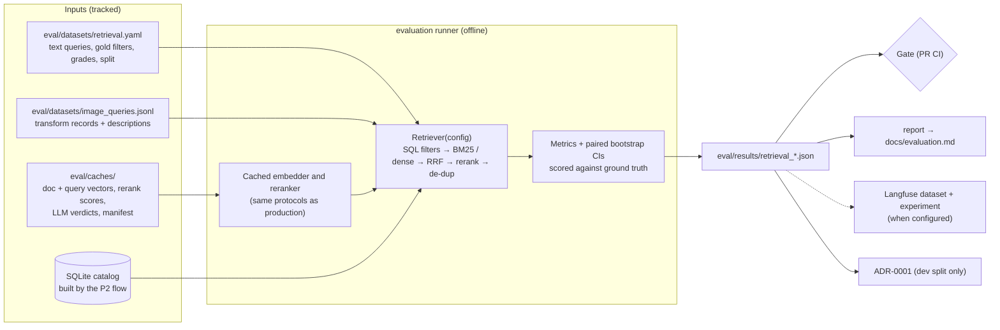
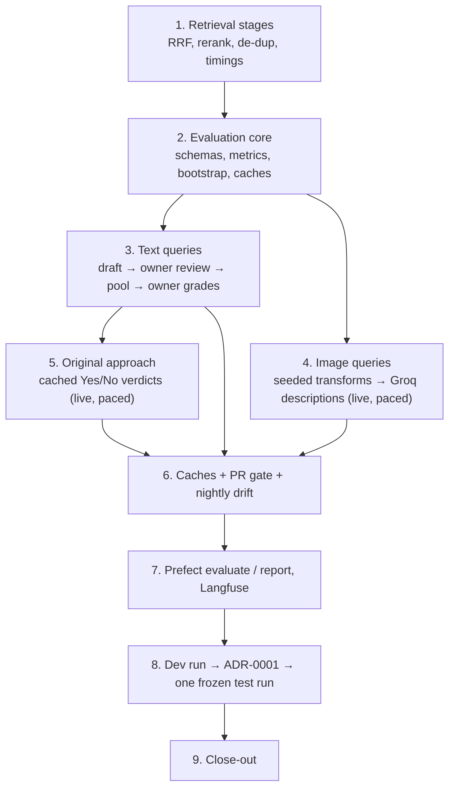

# Phases — remaining sprints

> Revision 3 (2026-09-24): adds multi-agent orchestration, A2A, reranker + Qdrant, Prefect, guardrails/access control and a Responsible AI programme. Only remaining work is planned. Baseline: `prd.md` §2. Budgets, optimisation and staging: [`optimization.md`](optimization.md). Progress: [`CHANGELOG.md`](../../CHANGELOG.md) and ADRs in [`docs/adr/`](../adr/). Audit refs (A#, and "audit #N" in `architecture.md`) are summarised in the [audit reference index](#audit-reference-index) below; the full audit is kept locally because it quotes material that is not redistributed. Feature refs (F#) → `prd.md` §6.

Size: **S** small · **M** medium · **L** large (split into several PR-sized commits).

Every phase ends with something demonstrable. The walking skeleton is live at the end of Phase 4.

## Skill coverage map

| Job-market skill | Where it is demonstrated |
|---|---|
| Agent frameworks (LangGraph; why not CrewAI/AutoGen) | P5 + ADR-0003 |
| Multi-agent orchestration (supervisor, planner-executor, routing) | P5, measured in P6 |
| Agent-to-agent (A2A) | P8 |
| MCP / tool standards | P4 |
| Function calling / API orchestration | P4, P5, P7 |
| RAG: retrieval + ranking (BM25, dense, hybrid, reranker) | P3 |
| Vector databases (FAISS, Qdrant) | P2, P3 |
| Agent memory (short-term, long-term, contextual) | P5 |
| Workflow orchestration (Prefect) | P2, P3 |
| Cloud AI (AWS Bedrock, stub-tested) | P1 |
| LLMOps (tracing, prompts, datasets, experiments, gates, monitoring) | P1, P3, P6 |
| Guardrails (safety, compliance, fallback) | P5, P7 |
| Prompt-injection protection | P5, red-teamed in P6 |
| Tool access control and data governance | P4, P5, P7 |
| Responsible AI (bias, fairness, complexity, confusion matrices) | P9 |

---

## Git workflow

- `main` ← one short-lived branch per workstream, cut from the latest `main` and deleted after merge. Names: `feat/p<N>-<topic>` (e.g. `feat/p1-embeddings`), or `fix/`, `docs/`, `chore/`, `build/` for other kinds of change. The phase heading gives the prefix.
- One topic per pull request; a phase is the unit of planning, a workstream the unit of review. A branch is never reused after its PR merges, so no "update branch" merges are needed.
- Conventional Commits with scope; no AI/tool references; no co-author trailers (`engineering-rules.md` §8).
- **GitHub Issues track the work.** Each phase is a milestone; each workstream, follow-up, audit finding and bug is an issue in it, labelled by type (`task`, `bug`, `follow-up`, `audit`), `area:*` and `priority:*`, plus `needs-owner` and `live-calls` where they apply. A PR names its issue with `Closes #N`, so merging closes it. A bug found mid-work gets its own issue instead of a silent fix inside an unrelated PR. A phase plan creates its workstream issues once the plan merges; carried-forward items stay open in the next milestone.
- End of each workstream: tests + gates green → push and open the PR → **stop for review** → the owner merges. End of phase: CHANGELOG, plan and ADRs up to date, and the phase marked done.
- Public repo, no LICENSE. Tags: `v0.1.0` (P4 live MCP), `v0.2.0` (P7 live demo), `v0.3.0` (P8 A2A), `v1.0.0` (P10).

---

## Phase 0 — Foundation ✅ `chore/phase-0-foundation`, `chore/phase-0-closeout`
Done: package skeleton, settings, error hierarchy, logging, CI with secret scanning, `main` ruleset, ignore rules for credentials and user data, defect log, audits, plan revisions 2–3. Course baseline analysed locally and **not redistributed**.
Close-out (Phase 0 audit, 2026-09-25): settings aligned with `.env.example` (paid-provider opt-in enforced, unknown `.env` keys rejected); log values escaped against injection; tests isolated from the shell environment; mypy (strict) and pip-audit in CI; weekly full-history secret scan; 5 MB file check; third-party action pinned; CHANGELOG and ADR index started. `main` was already protected by a repository ruleset.

**DoD:** lint, strict type check, offline tests (100% coverage of `src/`), dependency audit and secret scan green in CI; `.env.example` and `Settings` checked against each other by a test; `main` accepts changes only through pull requests with green checks.

## Phase 1 — Models, embeddings, telemetry ✅ `feat/p1-*` (started as `feat/phase-1-models-telemetry`) · L
**Goal:** one model layer that every later phase calls: typed, with fallbacks, bounded by a request deadline, traced and masked. Plus a measured profile of what each free model can reliably do, which P3–P6 choices depend on. Provider selection, fallback order and `ALLOW_PAID_PROVIDERS` landed in the Phase 0 close-out; A20 and A24 are closed.

Decisions (2026-09-30): Langfuse self-hosted with Docker for development (WSL2 memory capped), Langfuse Cloud Hobby from the P4 demo; `uv` generates the lock files; `qwen2.5vl:7b` for local vision, `qwen2.5vl:3b` if it does not fit in 8 GB VRAM; heavy caches (fastembed, Docker volumes, Ollama) live outside the synced project folder.

1. **Dependencies (A19):** `requirements.lock` (runtime, for Docker) and `requirements-dev.lock` (CI), universal and hash-checked; SDKs capped below their next major; CI fails when a lock no longer matches `pyproject.toml`, and audits both locks.
2. **Settings:** model names per provider and role (`chat`, `vision`, `router`, `judge`), blank until verified live; a deadline for one model call across the fallback chain (default 8 s, the PRD p95 target), per-provider attempt timeouts (Groq 3 s, Gemini 5 s, from first measurements) and SDK retries only on the last provider, since the next provider is the retry and 30 s × 3 attempts × 2 providers cannot meet it; per-minute and per-day call caps for free providers; tracing switch, sample rate and environment.
3. **`models/router.py`:** `ChatOpenAI(base_url=…)` for Groq, Gemini and Ollama, `ChatBedrockConverse` behind the paid flag, `ScriptedChatModel` (scripted messages, tool calls and exceptions) for tests. SDK retries and `.with_fallbacks` only. Fallback on 429, timeout, 5xx, connection and auth errors (auth logged at ERROR); no fallback on 400. One translation from provider exceptions into the `Provider*Error` hierarchy. A capability table per provider (tools, JSON schema, vision, streaming, usage) picks the structured-output method; one repair, then fallback. Temperature 0 and a seed for routing and extraction. Images stripped of EXIF before they leave the process. Reasoning effort is set per role (low for routing and extraction), and an empty reply counts as a failed attempt: on 2026-09-30 thinking models spent a small output budget on hidden reasoning and returned nothing visible.
4. **`models/embeddings.py`:** fastembed `BAAI/bge-small-en-v1.5` (quantised ONNX, 384-d) with separate query and passage embedding; fastembed does not add BGE's query instruction, so it is a setting, recorded in the fingerprint and measured with and without in P3. L2-normalised and batched. fastembed cannot pin a revision, so an `EmbedderFingerprint` (model, snapshot revision, model-file SHA-256, dim, normalisation, query prefix) is stored in every index manifest, and loading a mismatched index fails. A token-hashing fake embedder, so offline tests can assert ranking order. Cross-encoder rerank wrapper for P3 (`Xenova/ms-marco-MiniLM-L-6-v2`, Apache-2.0; CC-BY-NC rerankers excluded). A nightly workflow checks the real model against committed reference vectors (cosine ≥ 0.999).
5. **`telemetry.py`:** a thin wrapper over the Langfuse v4 (OpenTelemetry) SDK: traces, spans, LangChain callback, flush, `trace_id` in log lines; a no-op when disabled or unconfigured; failures logged and swallowed. One `TraceMeta` model (request, provider, model, role, fallback used, attempts, tokens, prompt version, degraded). A recursive, size-bounded masking function for image data, bytes, emails and phone numbers, tested in both directions: PII is masked, and prices, calories, dates and IDs are not. `docker-compose.yml` for local Langfuse with pinned images bound to 127.0.0.1.
6. **Tests:** contract tests per OpenAI-compatible provider through an injected `httpx2.MockTransport` (success, 429 → fallback, 5xx → one retry → fallback, timeout, 400 without fallback, auth, malformed output → repair → error, deadline); botocore Stubber for Bedrock and its paid-flag guard; masking, fake models, fingerprint mismatch. Coverage stays at 100% of `src/`.
7. **Model profile (live, never in CI):** candidates come from real calls, not model listings (on 2026-09-30 Gemini still listed 2.5 models that refuse new accounts with 404). Per provider and role, a fixed set of 20 prompts measures structured-output adherence (first try and after repair), tool-call accuracy, p50/p95 latency and tokens, vision on own photos, and rate-limit headers; Llama Guard-class availability recorded for P5. Results in `eval/results/` with sample sizes and intervals; model names and fallback order in **ADR-0006**.

**DoD:** offline tests green at 100% coverage with lint, strict types, both lock audits and the secret scan; CI installs from the lock; live smoke on Groq, Gemini and Ollama visible as masked traces in local Langfuse; a forced Groq failure served by Gemini; Bedrock stub contract passes; ADR-0006 accepted with measured numbers.

**Status (2026-10-01):** items 1–7 built; ADR-0006 accepted (Groq `openai/gpt-oss-20b` → Gemini `gemini-3.5-flash-lite`).

**Status (2026-10-06):** the Phase 1 audit's high and medium findings are fixed except M5 (PRs #12–#15: coverage gate, request deadline, enforced call and token caps, metadata-only production traces, embedder fingerprint).

**Live smoke passed** (`scripts/smoke_live.py`; `eval/results/smoke_2026-10-06T1228Z.json`, commit `e0197b4`):
- Groq, Gemini and Ollama each answer.
- A forced Groq authentication failure is served by Gemini, with the fallback recorded.
- Typed output validates.
- Traces in local Langfuse 4.48 arrive masked with `TRACE_CONTENT=full`, and with no content at all with `TRACE_CONTENT=metadata`.

**Negative result, same day.** On the first run, Gemini hit its 5 s attempt timeout on both of its calls (5.1 s and 5.2 s), so the forced fallback failed too. That run's results file was overwritten by a later one (since fixed), so these numbers come from its console output.
- Direct probes straight afterwards took 12.7 s and 7.7 s.
- A paced series of six then had a median of 2.0 s and a maximum of 6.3 s; 5 of 6 were under 5 s.
- The profile's p95 on 2026-10-01 was 1.25 s.

Calls after an idle stretch appear slow. So whether the fallback works inside the 8 s deadline is not settled, which is ADR-0006's revisit trigger. It is to be measured over a longer window before the P4 demo relies on it.

**Closed 2026-10-06.** Every DoD item is met except vision, which is **deferred to Phase 2 item 7** by the owner's decision: no own photos were available, and Phase 2 describes ~150 openly licensed catalog photos with the same local model, which is a larger and reproducible test set. No vision default is configured until then. `scripts/smoke_live.py --photos <folder>` still measures own photos whenever they are available.

Carried forward:
- Gemini latency after idle periods, to be measured over a longer window **before the P4 demo** relies on the fallback (ADR-0006 revisit trigger).
- Larger routing and tool-call sets with a dev/test split **before P5** (audit M5).
- Streamed token usage for the token cap, which needs a live probe before `stream_usage` is enabled.
- Low-severity audit items as their code is touched.

## Phase 2 — Data, safety and ingestion flows · `feat/p2-*` · L
**Goal:** a trustworthy, publishable catalog with safety-checked allergen tags, built into SQLite and search indexes by orchestrated, repeatable flows. Phase 3 measures retrieval on this data, and Phases 4–5 enforce constraints with it.

Decisions (2026-10-06):
- **Cuisines:** mainly Indian, about 70% across regions, with the rest from other cuisines (see item 1).
- **Photos:** Wikimedia Commons only.
- **Images not committed:** they are fetched by script and pinned by SHA-256, so the repository stays small and every file's licence is checked at fetch time.
- **Vision measurement:** deferred from Phase 1 to item 7.
- **Size:** L rather than M: the catalog and its hand-checked allergen ground truth are real authoring work.

1. **Own catalog (`data/raw/`, tracked, synthetic by design).**
   - **Scope:** ~150 dishes across ~15 fictional restaurants, about 10 of them Indian: North Indian, South Indian, Mumbai street food, Hyderabadi/Mughlai, Bengali, Gujarati thali, Kerala, Punjabi dhaba, Indo-Chinese, mithai and desserts. The other ~5: a café, a pizzeria, a bakery, a healthy-bowl kitchen and a pan-Asian kitchen.
   - **Restaurants and prices:** names are invented and checked not to match a real business, and prices are in INR.
   - **Files:**
     - `restaurants.csv` (id, name, cuisine, city area, rating);
     - `menu.csv`, with one row per dish at a restaurant: name, description, category, cuisine, ingredients, diet, serves, price, kcal, protein/carbs/fat g, rating and review count;
     - `label_allergens`: what the restaurant "declares", with deliberate, documented gaps (~30% unlabelled) because real menus are like that;
     - `true_allergens`: hand-checked ground truth, used only by tests and evaluation, never by the system.
   - **Nutrition:** plausible per-serving values, not measurements. Each passes the Atwater check (4P + 4C + 9F within 25%). The data card says so.
   - **Variation on purpose:** some dishes appear at more than one restaurant, to exercise `dish_key` de-duplication (A13).
   - **Review:** drafted in batches, and the owner reviews every `true_allergens` entry before the batch merges. That review is the ground truth's authority.
2. **Photos (Wikimedia Commons).**
   - **Candidates:** `scripts/fetch_photos.py` queries the Commons API per dish and keeps only CC0, public domain, CC BY and CC BY-SA files. NC, ND, GFDL-only and unknown licences are refused.
   - **Review:** candidates are written to `data/raw/photo_review.csv`. The owner approves one per dish or marks it as having no suitable photo, which is allowed and recorded.
   - **Attribution:** approved photos go to `data/raw/attributions.csv` with file page URL, author, licence, licence URL, SHA-256 and original size.
   - **Fetch:** downloads use a descriptive User-Agent with the repo URL (Commons API policy), are paced, and are verified against the hash. A mismatch fails.
   - **Storage:** images are cached outside the repo, next to the model cache (a new setting), never in the synced project folder.
   - **Thumbnails:** WebP ≤ 480 px, built locally, never committed.
   - **Attribution display:** the UI shows author and licence wherever a photo appears (P7).
3. **Loader and normalisation (`ingestion/`).**
   - **Validation:** pydantic row schemas for every CSV. Every bad row is reported, not just the first. Every photo needs an attribution row.
   - **Normalisation:**
     - diet: `vegan`, `vegetarian` (lacto-ovo) or `non_vegetarian`, plus `contains_egg`, which drives `eggless` (A11);
     - cuisine vs category;
     - `serves` becomes min/max;
     - the Atwater check.
   - **Rejections:** a dish whose diet contradicts its ingredients (an egg in a vegan dish) is an ingestion error, not a warning.
4. **Allergens (`ingestion/allergens.py`, A1, A2, A12).**
   - **Taxonomy:** EU-14 ∪ US Big-9 as 15 keys: `gluten`, `wheat`, `crustaceans`, `molluscs`, `fish`, `eggs`, `milk`, `peanuts`, `tree_nuts`, `soy`, `sesame`, `mustard`, `celery`, `lupin`, `sulphites`. User terms map onto them: "shellfish" → crustaceans + molluscs, "dairy"/"lactose" → milk, "coeliac"/"celiac" → gluten.
   - **Three sources, each tag stored with source and level:**
     - `label` → `contains`;
     - a versioned ingredient lexicon (`data/lexicon/allergens.yaml`; covers Indian terms such as ghee, paneer, khoya, maida, besan, atta, hing (often wheat-based), kaju, badam, til, sarson) → `contains`;
     - vision description terms → `may_contain`.
   - **Opaque ingredients** (masala mixes, "gravy base", namkeen, chutneys without a listed recipe) set `unverified`.
   - **Safety property (the gate):** for every dish, every `true_allergens` entry is tagged `contains` or `may_contain`, or the dish is `unverified`. Recall is 100%: no allergen goes unflagged. Precision per allergen is reported, not gated (P9 builds confusion matrices from it).
5. **SQLite catalog (`storage/`, A13, A14).**
   - **Schema:** restaurants, dishes and items (a dish at a restaurant), `allergen_tags` (item, allergen, source, level), images, descriptions.
   - **De-duplication:** `dish_key` groups the same dish across restaurants.
   - **Filtering:** indexed columns serve `candidate_ids(constraints)`.
   - **Document text:** semantic only (description, name, cuisine, ingredients, diet); numbers stay in SQL.
   - **Build:** written to a temporary file and swapped in atomically.
6. **Indexes (`services/retrieval`, `storage/`).**
   - **One interface:** a `VectorStore` protocol with FAISS (`IndexIDMap2(IndexFlatIP)`) and Qdrant (local mode, payload filters) backends; BM25 (`rank-bm25`) over the same text.
   - **Manifest:** embedder fingerprint, dimension, item count, data SHA-256, `doc_text_version`, created at. Loading under a different fingerprint or data hash fails (the P1 fingerprint, used).
   - **No pickle:** FAISS's native format plus JSON (defect #11).
7. **Descriptions and vision measurement (A7, deferred from P1).**
   - **Generation:** local `qwen2.5vl:7b` (`3b` if 8 GB of VRAM is not enough) writes a **name-free** description per photo (for P3's image queries) and a name-conditioned one (for comparison).
   - **Caching:** descriptions are cached by image SHA-256 in `data/processed/image_descriptions.jsonl`. That file is tracked, so CI and the HF build never need Ollama.
   - **Measurement:** latency p50/p95 per image. A hand-checked sample of 30 descriptions is scored for dish type, visible ingredients and allergens claimed that aren't in the photo.
   - **Decision:** the vision default goes in **ADR-0007**, after weighing Gemini's free-tier data terms (`docs/data-handling.md`) before any hosted vision model.
8. **Flows (`flows/`, Prefect OSS, local).**
   - **Flows:** `ingest` (validate, normalise, allergens, descriptions for new photos only, catalog) and `build_index` (embed, FAISS + Qdrant + BM25, manifest).
   - **Behaviour:** tasks retry only on transient failures and are cached by input hash, so a second run with unchanged inputs does nothing. CLI wrappers are provided.
   - **Tests:** in-process (`prefect_test_harness`) on a 12-dish fixture catalog.
   - **Nightly:** the existing nightly workflow runs `build_index` with the real embedder (model download allowed there only).
9. **Dependencies:** `qdrant-client`, `rank-bm25` (runtime) and `prefect` (the `ingest` extra, so the API image stays small). All three are already approved in rules §1; the locks are regenerated in the PR that first uses them.
10. **`docs/data-card.md`:**
    - **Sources:** authored text, Commons photos with licences.
    - **Disclosures:** which fields are synthetic and how; the deliberate label gaps; known limitations (not medical-grade, nutrition approximate, Indian-centric).
    - **Lineage:** data hash → manifest → evaluation runs.

Workstreams (one PR each, in order; the owner reviews before each merge):

| Branch | Delivers | Owner input |
|---|---|---|
| `feat/p2-catalog-schema` | row schemas, taxonomy and user-term map, loader, normalisation, Atwater and diet checks, all on a 12-dish fixture | — |
| `feat/p2-catalog-data` | `restaurants.csv`, `menu.csv` with labels and ground truth, in 3 batches of ~50 | **review `true_allergens`** per batch |
| `feat/p2-allergens` | lexicon, three-source tagger, safety-recall gate and precision report | review lexicon additions |
| `feat/p2-photos` | Commons fetch, review sheet, attributions, hash-pinned download, thumbnails | **approve photos** (`photo_review.csv`) |
| `feat/p2-storage` | SQLite schema and builder, `dish_key`, document text | — |
| `feat/p2-indexes` | `VectorStore`, FAISS, Qdrant, BM25, manifest, property test | — |
| `feat/p2-descriptions` | name-free and named descriptions, the vision measurement and ADR-0007 | **run** the local vision job (or let it run on this machine) |
| `feat/p2-flows` | Prefect flows, CLI, nightly `build_index`, data card | — |

**DoD:**
- One command builds the catalog, tags, descriptions (from cache), SQLite and both indexes, and a second run is a no-op.
- The allergen safety gate passes: 100% recall against the owner-reviewed ground truth on every dish, with precision per allergen reported.
- Property test on both backends: filtered search never returns a dish that violates diet, allergen, calorie, price or cuisine filters.
- Every photo has a licence record, and no NC or ND file is present.
- The vision measurement is committed and ADR-0007 accepted.
- `docs/data-card.md` is published, and offline tests stay at 100% coverage.

**Closed 2026-10-09.** All eight workstreams merged (PRs #20–#36), every DoD item met, ADR-0007 accepted.

| Workstream | PR | Result |
|---|---|---|
| `feat/p2-catalog-schema` | #20 | schemas, 15-key taxonomy, loader reporting every bad row, diet and Atwater checks |
| `feat/p2-catalog-data` | #21–#23 | 150 dishes at 15 fictional restaurants (67% Indian); 31% unlabelled on purpose; ground truth reviewed by the owner per batch |
| `feat/p2-allergens` | #24 | lexicon v1 and three-source tagger; **safety gate passes** (no untagged true allergen on a verified dish); 25 of 150 unverified (17%), capped at 25% |
| `feat/p2-photos` | #25 | Commons tooling; 696 licence-checked candidates for all 150 dishes; review page keeps choices across reloads (#30); **owner approved 131 photos, 19 dishes without one** (this PR) |
| `feat/p2-storage` | #26 | SQLite catalog; `dish_key` (6 dishes at two restaurants); semantic `doc_text`; SQL filters checked against `Filters.admits` on 400 random combinations |
| `feat/p2-indexes` | #27 | FAISS, Qdrant and BM25 with a manifest; **property test passes**: no filtered search on any backend returns a violating dish (300 random combinations) |
| `feat/p2-flows` | #28 | `python -m food_concierge.flows build`; a second run is a no-op (also checked nightly with the real embedder); `docs/data-card.md` |
| `feat/p2-descriptions` | #32 | `qwen2.5vl:7b` locally: name-free and named descriptions of all 127 photos, cached and tracked; name-free text feeds the allergen tagger as `may_contain` |
| vision measurement | #33–#36 | 30 seeded photos scored by the owner for local `qwen2.5vl:7b` and Groq `qwen/qwen3.8-27b`: dish type 23/30 vs 22/30 correct, false allergen terms 4/25 vs 3/24, p95 4.8 s vs 0.9 s. Lexicon v2 (#34: "til" no longer matches "tiles"). **ADR-0007 accepted** (#36): Groq describes user photos with no Gemini fallback; vision tags warn instead of filter, which restores 47 false exclusions on 29 dishes |

DoD:
- One-command build and no-op re-run: met, descriptions included from the cache.
- Allergen safety gate: met, now on `contains` tags (the ones search filters on).
- Property test on both backends: met.
- Data card, and 100% coverage (494 tests): met.
- Every photo has a licence record and no NC or ND file is present: met (131 attributions, each hash-pinned).
- Vision measurement committed and ADR-0007 accepted: met.

Deviations from the plan above, each recorded in the PR that made it:
- Qdrant runs in memory, rebuilt from the saved vectors at load: its on-disk local mode persists points with pickle (rules §1).
- Hard filters are decided once in SQL; backends restrict to those ids instead of each applying payload filters, so the rules live in one place.
- "Re-run is a no-op" comes from explicit input-hash checks, not Prefect's result cache, whose default serializer is pickle.
- `doc_text` adds the menu category to the plan's fields (`DOC_TEXT_VERSION` 1).
- The allergen precision figures are in-sample: the lexicon was written against this catalog.
- Vision `may_contain` tags do not filter search, and the gate checks `contains` only (ADR-0007). Item 4 planned vision tags as a filter and part of the gate.
Follow-ups carried forward:
- P4: the usage ledger keys token caps by model (Groq limits per model), budgets photos separately from chat, and stays below Groq's figure (ADR-0007).
- Lexicon: negations ("no nuts") and hedged alternatives ("spices or nuts") produce false vision terms; fix when the lexicon next changes. (Negations done in #54; hedges kept, as most are right: ADR-0007.)

## Phase 3 — Retrieval evaluation, ranking and baselines · `feat/p3-*` · L
**Goal:** the "before" numbers and a CI gate, before any agent logic (A5). Phase 3 measures how well each retrieval stack finds the right dishes on the Phase 2 catalog, picks the stack and vector backend from development-split evidence (ADR-0001), and makes any later regression fail CI. P4's `/v1/search` and MCP `search` tool use the configuration chosen here.

Sized L rather than M: the owner's relevance labels are real authoring work, as the allergen ground truth was in Phase 2, and the image queries and the original-approach baseline each need a paced live job.

**Status (2026-10-14):** workstreams 0–7 are merged (#38, #62–#69), the query set was reduced to 62 drafted queries (#70), and the documents were brought up to date (#71). `uv.lock` is now git-ignored (#72), the Langfuse mirror has been checked against a running Langfuse (#73), and the per-photo token count was fixed (#76). While the grades are pending, Phase 4 groundwork that needs neither grades nor Groq quota has gone ahead (see Phase 4). Where work stands:
- **Owner grading (#42):** the blind grading page covers 1,179 pooled dishes across the 62 queries. It is the critical path. After it come `label_queries.py import` and `split`, the gate baseline update (`retrieval_gate.py --update`) and regenerated results.
- **Image descriptions (#43):** as of 2026-10-14, all 127 photos have L0, 119 have L1 and 113 have every rung: 111 on main (#79, #80, #87, #88, #91, #93) and two more in draft #94. About 22 Groq calls remain (8 L1 + 14 L2), one run's worth. Groq caps `qwen/qwen3.8-27b` at about 200,000 tokens in a rolling 24 hours, which is about 100 descriptions at roughly 1,900 tokens each, so the job spans several days instead of the planned 1.5 h. The earlier figure of about 1,430 tokens and 140 a day was too low (see the deviations below). Each run stops cleanly at the cap and keeps every photo it finished. A run soon after another one stops gets only a few calls (3 to 5 on 2026-10-14), because the window frees up only as the earlier calls age out of it; the productive run is the first one after about a day's gap (24 calls on 2026-10-14). The descriptions stay on Groq to the end: L1 and L2 measure the runtime vision model (ADR-0007), so switching models part-way would mix two models in one rung.
- **ADR-0001 and the final test run (#47):** these wait for grades. Latency has to be measured with the real models, since the cached ones only look scores up. Rerank so far is about 51 ms, 120 ms and 280 ms at the median for depths 5, 10 and 20.
- **Close-out (#48).**

Deviations so far, each recorded in its PR:
- C0 took 310 Groq calls and about 64k tokens, not about 360 calls, because 62 queries were run instead of 72. The strict and fixed parsers agree on this catalog: the model always replied exactly "Yes" or "No", so defect #4 did not fire.
- Rerank depth 10 was added as a candidate (#69).
- The Langfuse mirror was checked on 2026-10-12 against the local Docker Langfuse (4.48.0), using the committed `retrieval_2026-10-11_all.json`. It wrote the `retrieval-all` dataset with 62 items, 1,054 experiment runs (17 candidates × 62 queries) and 1,054 `violation@3` scores, with the same mean as the results file (0.0047). The owner checked the run comparison view in the web UI. nDCG@3 and Success@3 appear once the grades are in. Langfuse 4 runs in events-only mode, so the legacy traces, scores and dataset-runs read endpoints return 404. The check read the data back through `/api/public/v2/observations`, `/api/public/v3/scores` and `/api/public/v2/metrics`.
- The per-photo token count that `describe` writes is unreliable (#74). It is taken as the change in the ledger's rolling one-minute total, so earlier calls that age out during a call are subtracted. Of 123 Groq rungs, 2 record 0 tokens, 2 record about 20 and 16 fall between about 500 and 950. The other 103 have a median of 1,922, which agrees with ADR-0007's figure of about 1,900. The earlier figure of about 1,430 tokens, which put the daily rate at 140 photos, isn't backed by the recorded counts: their mean was 1,667 at the time, pulled down by these undercounts, and the median was 1,919. How 1,430 was derived wasn't recorded. At about 1,900 tokens the rate is about 100 photos a day. Pacing and the descriptions are unaffected. Fixed on 2026-10-12: both describe scripts now use the ledger's running token total. Rows written earlier keep their values, so the field is only reliable for rows written from then on. That includes the Phase 2 measurement file, where four of 30 rows (885–921) look undercounted; ADR-0007's median of about 1,900 is unaffected.

### What Phase 3 does and does not measure
- **Measures:** ranking quality given the correct hard filters; how photos degrade search; latency of each retrieval stage; the original approach re-implemented on this catalog.
- **Does not measure:**
  - turning natural language into filters ("vegan under 400 kcal" → `Filters`): queries carry **gold filters**, and parsing errors are measured with the agent in P5–P6 (A15);
  - answer quality or explanations (P6, calibrated judge);
  - real user photos (none are available; altered catalog photos give a **lower bound**, A4).
- **Production defaults do not change** until ADR-0001 is accepted.

### Architecture

- **One retrieval code path.** The stages live in `services/retrieval.py` as a `Retriever` driven by a `RetrievalConfig` (mode `bm25 | dense | hybrid`, backend `faiss | qdrant`, rerank depth or none, de-duplicate by `dish_key` or not, `k`). The evaluation runs the same class that P4 serves, not a copy.
- **Offline by construction.** `CachedEmbedder` and `CachedReranker` implement the existing `Embedder` and `Reranker` protocols from committed caches and carry the real model's fingerprint. CI therefore runs the real pipeline with no model download (rules §5.4). A query or item missing from the cache is an error, never a silent zero.
- **Hard filters stay in SQL** (`candidate_ids`, Phase 2). Every candidate except the original approach searches only admitted items.
- **Code location:** metrics, datasets, caches, runner, gate and report go in a new `food_concierge/evaluation/` package. It is typed and inside the 100% coverage gate. `eval/` keeps only data: datasets, caches, gate baseline and results.

### Workflow

Items 3 and 4 run in parallel: the Groq photo job runs while the owner grades.

### 1. Text queries (`eval/datasets/retrieval.yaml`, A3, A6)
- **62 queries, 10–12 per type** (72 were planned, 10 of them the owner's; see the authoring bias below):

  | Type | Example | Main metric |
  |---|---|---|
  | Known item, by name or spelling variant | "butter chicken", "biriyani" | Recall@3/10, MRR |
  | Described without the name | "crispy rice-and-lentil crepe with a potato filling" | Recall@3/10, MRR |
  | Vague intent or mood | "something warm and comforting for a rainy evening" | nDCG@3, Success@3 |
  | Ingredient or attribute | "dishes with coconut and curry leaves" | nDCG@3, Success@3 |
  | Hinglish, regional terms, typos | "paneer wala starter", "bhindi", "panner tikka" | nDCG@3, Success@3 |
  | Semantic need plus gold filters | "light lunch" + vegan, no peanuts, ≤ 450 kcal | nDCG@3, **Violation@3** |

- **Authoring bias:** a query written by someone who has read the catalog reuses its words, which flatters BM25. To limit that, drafted queries must paraphrase rather than copy the menu text, and the owner was to write about 10 queries **without looking at the catalog**, spread over the middle four types. On 2026-10-11 the owner chose to go ahead with the 62 drafted queries only, so every query was written with the catalog in view. The bias can't be checked as a slice; it is stated next to the results instead, and BM25's numbers in particular may be flattered.
- **Split:** dev and test 50/50, stratified by type with a fixed seed. Near-duplicate queries share a `group` and go to the same side. The dataset file records the test split's SHA-256. The runner refuses `--split test` unless given `--final`, and the final run happens **once**, after ADR-0001's decision.
- **Grades 0–3:**
  - 3: exactly what was asked;
  - 2: relevant;
  - 1: related, but wrong on something that matters;
  - 0: not relevant.

  The guide in `eval/datasets/labelling-guide.md` gives two worked examples per grade. For known-item queries, every item sharing the target's `dish_key` is a 3.
- **Pooling (TREC-style):** each query's pool is the union of the top 10 from every candidate below. That is about 15–20 unique items a query, so roughly 1,100–1,400 judgements. The owner grades them in a local review page like the photo review (#30): pairs are shuffled, the producing system is hidden, choices survive a reload, and the page exports a CSV. Unjudged items count as 0. Every result reports judged@3 per candidate. A configuration added after pooling with judged@3 below 95% gets its new pairs graded before it is compared.
- **Consistency:** a week later the owner re-grades a seeded 10% sample, and weighted Cohen's κ is reported. With a single annotator there is no inter-annotator agreement, so this is the substitute, and the limitation is stated.

### 2. Image queries (`eval/datasets/image_queries.jsonl`, A4, A7)
- **Source:** all 127 described catalog photos, read from the local photo cache. Photos are not in the repository, so this step runs only on a machine that holds them.
- **Transforms** (`evaluation/image_transforms.py`, Pillow, seeded per photo): each query applies 2–3 of the following, with parameters drawn from the seed:
  - random crop to 60–90% of the area;
  - rotation within ±25°;
  - brightness, contrast and colour shifts;
  - Gaussian blur;
  - JPEG re-compression at quality 30–60;
  - **backdrop change, approximated:** the photo is shrunk onto a plain or textured canvas. True background replacement needs a segmentation model the rules do not include, so this is recorded as a limitation.

  Each query records the transforms, their parameters and the altered image's SHA-256. The altered images themselves are not committed. Anyone with the photos can regenerate them, and a SHA-256 mismatch (for example from a different JPEG encoder) gives a warning, not a silent pass.
- **Descriptions:** the production path from ADR-0007 is used: Groq `qwen/qwen3.8-27b`, the production name-free prompt, and EXIF stripped by the router. Every altered photo and every unaltered one is described, about 254 calls. At about 1,900 tokens a photo, Groq's 8,000 tokens a minute allows 3–4 photos a minute (ADR-0007), so the job takes about 1.5 h. It stays under the 900-a-day cap, paces itself and resumes, skipping photos already described.
- **Ladder** (A7). The gaps between the rungs are the result:
  - **L0:** named description of the unaltered photo, from the existing local cache. This is what the original approach effectively measured, and it leaks the name.
  - **L1:** name-free description of the unaltered photo: the sanity check.
  - **L2:** name-free description of the altered photo: the **reported lower bound**.

  L0 uses local `qwen2.5vl:7b` and L1–L2 use Groq. That model difference is stated next to the numbers.
- **Labels:** the relevant items are those sharing the photo's `dish_key` (grade 3). Image queries are split 50/50 by `dish_key` with the same seed. Metrics: Recall@3, Recall@10, MRR and Success@3.
- **Coverage:** 19 dishes have no photo, so image results cover 131 of 150 dishes.

### 3. Candidates

| ID | Candidate | Notes |
|---|---|---|
| C0 | **Original approach, re-implemented** | Raw query, dense top 5 with no hard filters, then one LLM Yes/No relevance call per item. Constraints appear only in the prompt. Groq `openai/gpt-oss-20b`, temperature 0, seed. Reported twice: with the original's strict parser (`== 'yes'`, defect #4) and with a fixed one. It uses this project's embedder, because the original's paid models are off by default (rules §5), so it re-implements the method and is not a replay. About 360 calls, paced and cached |
| C1 | BM25 | Lexical baseline (A8) |
| C2 | Dense, FAISS | With and without the BGE query prefix (carried from P1) |
| C3 | Dense, Qdrant | Both are exact search, so rankings must equal C2's; the comparison is latency, cold load and memory (A26) |
| C4 | Hybrid: RRF of C1 and C2 | Fixed `k_rrf = 60`, 20 results from each list. Not tuned, so nothing is fitted to about 31 dev queries (A16) |
| C5 | C4 + cross-encoder rerank, at two depths: top 10 (C5-10) and top 20 (C5-20) | `Xenova/ms-marco-MiniLM-L-6-v2` (F20). Trained on English web search, so the Hinglish slice is reported separately. Depth 10 was added on 2026-10-11, before any graded dev number existed, because the measured rerank latency (about 120 ms for 10, 280 ms for 20 at the median on the reference laptop) puts depth 20 at risk of the 150 ms guard |

Every candidate is also measured with `dish_key` de-duplication on and off (6 dishes appear at two restaurants).

### 4. Metrics (A6, A18)
- **nDCG@3**, with gain `2^grade − 1` and the ideal ordering taken from all judged items.
- **Success@3:** at least one item graded ≥ 2 in the top 3.
- **Recall@3, Recall@10 and MRR** for known-item and image queries.
- **Violation@3:** the share of top-3 items that break the query's gold filters. It is checked with `Filters.admits` against the **ground truth** (`true_allergens` and the catalog diet), not against the system's own tags, which keeps it non-circular (A3). The target is 0 for every candidate except C0. C0's violations are the headline "before" number.
- **Latency:** p50 and p95 for each stage (query embedding, search, fusion, rerank) over 5 warm repeats, plus cold load time and memory per backend. Measured on a recorded reference machine (CPU, cores, OS). The HF Space CPU is slower and is re-measured in P4.
- **Confidence intervals:** paired bootstrap over queries, 10,000 seeded resamples, 95% percentile interval. Slices are shown, but decisions use only the pre-registered metrics below.

### 5. Decision rules (pre-registered: committed with this plan, before any dev number exists)
1. A candidate with any Violation@3 against the ground truth is ineligible.
2. **Primary metric:** dev nDCG@3 over all text queries. **Guards:** image Recall@3 (L2) does not fall by more than 0.05, and retrieval p95 stays ≤ 150 ms on the reference machine. That is half the PRD's 300 ms, which leaves room for the slower Space CPU.
3. **Complexity ladder:** the better of BM25 and dense → hybrid → + reranker. A step is adopted only if the paired-bootstrap 95% CI of its ΔnDCG@3 over the previous step lies entirely above 0 and the guards hold. Otherwise the simpler step stays. For the reranker step, C5-10 and C5-20 are each compared with C4. If both qualify, C5-10 is adopted unless C5-20 beats it by the same rule with the guards holding; if only one qualifies, that one.
4. **Query prefix:** kept unless no prefix wins by the same rule. The prefix is part of the embedder fingerprint, so dropping it means rebuilding the index, which is cheap.
5. **Backend:** FAISS, unless Qdrant is at least 20% faster at p95 with equal rankings. The other backend stays as a tested alternative.
6. A tie goes to the simpler configuration. Then **one** test-split run of the chosen configuration and every baseline is reported as it comes out, including negative results, with no changes afterwards.

### 6. Caches and the PR gate
- **Committed caches (`eval/caches/`, under 2 MB):**
  - document vectors (150 × 384, float32 `.npy`, no pickle);
  - query vectors with and without the prefix;
  - a full query × item cross-encoder score matrix, so rerank depth can change without a cache miss;
  - C0's LLM verdicts, including the raw reply;
  - a manifest: embedder fingerprint, reranker model and file hash (a reranker fingerprint is added in item 1 of the workstreams), catalog `data_sha256`, `doc_text_version` and dataset SHA-256.
- **Building the caches:** `scripts/build_eval_cache.py` builds them locally, where model downloads are allowed. Any change to the catalog, the document text, the dataset or a model means rebuilding them in the same PR. The gate names the stale field.
- **Gate** (a new step in `ci.yml`, after the tests). It runs the dev split from the caches and is deterministic, so any change in a number comes from a code or data change, not noise. It fails when:
  - nDCG@3 drops more than 0.02 below `eval/gates/retrieval_baseline.json`;
  - any violation appears;
  - a cache is stale;
  - a cache misses a query or item.

  The baseline changes only in a PR that says why.
- **Degraded configurations (tested):** pytest runs the gate on a random-order ranker and on a pipeline that drops the SQL filters. Both must fail, which is the DoD's "deliberately degraded config".
- **Nightly:** it re-embeds the documents and queries and reruns the reranker with freshly downloaded models, then checks them against the caches (cosine ≥ 0.999; rerank scores within 1e-3). This follows the P1 drift pattern.

### 7. Flows, results and Langfuse (F12, F22)
- **`evaluate`** (Prefect):
  1. load the dataset and check the caches;
  2. run every configuration;
  3. compute metrics and CIs;
  4. write `eval/results/retrieval_<date>_<split>.json` with git SHA, data hash, fingerprints and machine;
  5. check the gate;
  6. mirror to Langfuse.
- **`report`:** renders `docs/evaluation.md` from the results JSON:
  - candidates × metrics with CIs;
  - slices;
  - the image ladder;
  - latency;
  - judged@3 and κ.

  Rendering is deterministic and tested.
- **CLI:** `python -m food_concierge.flows evaluate|report`.
- **Nightly:** `evaluate --check` runs after `build` and reproduces the committed results from the caches.
- **Langfuse:** each query becomes a dataset item, and each configuration becomes one experiment run with per-item scores (nDCG@3, Success@3, Violation@3). The mirror runs only when keys are configured, so in P3 it goes to local Docker Langfuse. GitHub Actions has no Langfuse keys, and a Langfuse Cloud account is P4's decision. Query text is synthetic, with no personal data. A mirror failure is logged and swallowed (rules §4.5).

### Limitations and risks (known before execution)

| Risk or limitation | Effect | Mitigation |
|---|---|---|
| Small query set (about 31 dev, 31 test) | Wide CIs: differences under about 0.05 nDCG@3 are unlikely to be resolved | Paired bootstrap; pre-registered rule that ties go to the simpler stack; the claims stay about this catalog only |
| One annotator, who also knows the catalog | Label and query bias | Blind, shuffled pools; κ on a re-graded sample; drafted queries paraphrase the menu. The owner's catalog-blind queries were dropped (2026-10-11), so the bias is stated with the results, not measured |
| Pool bias | Configurations outside the pool look worse | Pool depth 10 across every candidate; judged@3 reported; grade new pairs below 95% |
| Altered photos are not real photos | Image numbers can mislead either way | Reported as a lower bound next to L0 and L1; real photos are P7 or later |
| Backdrop change only approximated | Background robustness under-tested | Stated; segmentation is out of scope |
| Groq free-tier throughput (3–4 photos a minute), the 900-a-day cap and, as found in execution, about 200,000 vision tokens a day | The photo job spans several days rather than 1.5 h; C0 added 310 chat calls | Paced, resumable scripts; the two jobs run on different days; no Gemini fallback for photos (ADR-0007) |
| The vision model was found by a probe and may change (ADR-0007) | L1 and L2 may not be reproducible later | Descriptions are cached with model and prompt version; regenerating them is a new run, not an edit |
| LLM Yes/No verdicts are non-deterministic | C0 varies between runs | Temperature 0 and a seed, cached once; the raw replies are committed |
| An English-only cross-encoder | It may hurt the Hinglish and regional slice | Slice reported; the ladder rule decides adoption |
| Photos and models are not in the repository | Image queries and caches build only locally | CI uses committed caches only; the nightly checks for drift |
| Latency measured on a laptop | Not representative of the Space | 150 ms guard, half the 300 ms budget; re-measured in P4 |
| Query prefix inside the embedder fingerprint | Changing the prefix refuses the existing index | Intended; rebuilding is one command |

### Workstreams (one PR each, in order; the owner reviews before each merge)

| # | Branch | Delivers | Owner input | Live calls |
|---|---|---|---|---|
| 0 | `docs/p3-plan` | this plan | **approve** the plan and the decision rules | — |
| 1 | `feat/p3-retriever` | `RetrievalConfig` and `Retriever`: RRF, rerank stage, `dish_key` de-duplication, stage timings, reranker fingerprint; tests with the fake embedder and reranker | — | — |
| 2 | `feat/p3-eval-core` | `evaluation/`: dataset schemas and split lock, metrics checked against hand-computed values, paired bootstrap, cached embedder and reranker, cache manifest, runner | — | — |
| 3 | `feat/p3-text-queries` | labelling guide; 72 drafted queries with gold filters; pooling script and review page; graded `retrieval.yaml`; κ sample | **review the queries, grade the pools** (writing about 10 was dropped on 2026-10-11) (about 2 h over several sittings) | — |
| 4 | `feat/p3-image-queries` | seeded transforms; Groq descriptions of the altered and unaltered photos; L0–L2 query sets | let the paced job run on this machine (it needs the Groq key and the photo cache) | about 254 Groq vision |
| 5 | `feat/p3-original-baseline` | C0 with cached verdicts and both parsers | — | about 360 Groq chat |
| 6 | `feat/p3-gate` | `build_eval_cache.py`, committed caches, gate baseline, CI step, degraded-config tests, nightly drift | — | — |
| 7 | `feat/p3-flows` | `evaluate` and `report` flows, results JSON, `docs/evaluation.md`, nightly `evaluate`, Langfuse mirror | — | — |
| 8 | `docs/p3-adr-0001` | dev run → decision by the rules → ADR-0001 → one final test run | **accept ADR-0001** | — |
| 9 | `docs/p3-closeout` | plan, CHANGELOG, architecture, eval/README, report | — | — |

Critical path: workstream 3 (the owner's grading). Workstream 4 runs alongside it.

### Out of scope (deferred, with triggers)
- Multimodal image embeddings (backlog). Trigger: L2 Recall@10 below 0.5 while L1 stays high.
- Tuning RRF weights or `k_rrf`, query rewriting, HNSW.
- An LLM judge for relevance (P6).
- Natural-language-to-filter parsing (P5).

**DoD:**
- `retrieval.yaml` holds 62 owner-graded text queries; the image queries carry transform records; the dev/test split is locked by hash.
- C0–C5 (C5 at depths 10 and 20) are measured on dev with CIs, slices, judged@3 and latency, and the results are committed.
- From a clean checkout, `python -m food_concierge.flows evaluate` reproduces the committed dev numbers exactly from the caches, with no network.
- The PR CI gate is live. The random-ranker and dropped-filter configurations fail it in tests, and a stale cache fails it with a message naming the stale field.
- The nightly checks the caches against freshly downloaded models.
- ADR-0001 is accepted from dev evidence under the pre-registered rules, and one test-split run is reported, negative results included.
- `docs/evaluation.md` is generated, the Langfuse experiment is visible locally, and offline tests stay at 100% coverage.

## Phase 4 — MCP server, access control, first deploy · `feat/p4-*` · L
**Goal:** secure, reusable tools, live on HF Spaces.

**Status (2026-10-14):** started early, with work that needs neither Phase 3's grades nor Groq quota. Merged: the usage ledger keys caps by model, caps tokens per rolling day and budgets photos separately (#84, closes #49); the vision service downscales uploads and caches descriptions (#85, part of #53; the 768 vs 1,024 px experiment is still open); the image pixel limit became a setting and unused settings are marked reserved (#86, #57, #58); images given by URL or file id are refused (#89, #60); every Langfuse stack image is pinned by digest (#90, #59); vision allergen tags skip terms the description denies (#92, #54). The MCP server, access control, transports and the deploy (items 2–4 below) have not started.

1. `services/` layer (catalog, retrieval, allergens, nutrition, constraints, vision).
2. FastMCP server: 6 tools, 4 resources, 2 prompts; typed schemas; `isError`; size limits.
3. **Access control:** scoped bearer tokens (`public` / `agent` / `admin`) on the HTTP transport; per-tool scope checks; audit spans; rate limits per token + global.
4. Transports: stdio + Streamable HTTP in a minimal FastAPI app (`/health`, `/ready`, `/v1/search`, `/mcp`).
5. Tests: in-memory MCP sessions, schema snapshots, scope-denial tests, error paths. Manual: MCP Inspector, Claude Desktop (`docs/mcp.md`, `examples/claude_desktop_config.json`).
6. Dockerfile (slim, non-root, models cached at build); GitHub Action deploys to a HF Space on tag. ADR-0002 (MCP-first layering).

**DoD:** Claude Desktop uses the tools locally; the public Space serves `/v1/search` and MCP with scopes enforced; `v0.1.0`. Creating the HF Space needs approval.

## Phase 5 — Multi-agent system, memory and guardrails · `feat/p5-*` · L
**Goal:** a bounded, safe, observable multi-agent system over MCP.
1. Graph per Architecture §6: `guard_input` → `load_context` → supervisor → specialists (vision, recommender, meal planner) → deterministic `verify` → `confirm` (interrupt) → `respond` → `save_memory`; plus the **single-agent baseline graph**.
2. **Per-agent tool allow-lists**; budgets (tool calls, hops, repairs); safe fallback.
3. **Memory:** SQLite checkpointer (short-term), preference store with semantic recall (long-term), summarisation + trimming (contextual).
4. **Guardrails:** local injection classifier, content-safety screen, spotlighting of untrusted text, off-topic routing, output checks; inferred constraints surfaced for confirmation (A15).
5. Versioned prompts + `scripts/sync_prompts.py`; prompt version on traces.
6. Tests with the scripted fake model for every path (routing, repair, budget exhaustion, interrupt/resume, fallback, allow-list denial, injection fixtures); zero-violation assertions. ADR-0003 (LangGraph over CrewAI/AutoGen; supervisor design).

**DoD:** meal-planning scenarios run end to end on Groq with full traces; every graph path tested offline.

## Phase 6 — Agent evaluation, red-teaming and LLMOps · `feat/p6-*` · M
**Goal:** measured agent quality, security and operations.
1. `eval/datasets/agent.yaml` (~30 scenarios) and `eval/datasets/redteam.yaml` (direct/indirect injection, tool escalation, allergen override).
2. Metrics: task success, violations (0), tool-selection and routing accuracy, steps, repairs, latency, fallback rate, tokens + shadow cost; **attack success rate**; injection classifier TPR/FPR.
3. **Single vs multi-agent ablation**; default topology chosen from data (ADR-0004).
4. LLM-judge on local Ollama, calibrated vs ~40 human labels (κ) (A17).
5. Langfuse experiments (prompt versions, models); dashboards; `docs/evaluation.md` draft.
6. CI gates: agent trajectory tests + red-team suite with the fake model; live evals run manually and committed.

**DoD:** reproducible eval runs; judge calibration and red-team results reported; topology decision recorded.

## Phase 7 — API, UI and live demo · `feat/p7-*` · M
**Goal:** a polished, governed public demo.
1. FastAPI: `/v1/agent/runs` (SSE), resume, feedback → Langfuse scores; token scopes; rate limits; placeholder-key refusal; `DATA_DIR` (A9, A21, A22).
2. Streamlit per `design.md` §9: streaming chat, tool timeline, meal-plan card, interrupt buttons, constraint chips, preferences panel (view/delete), feedback, **AI-interaction disclosure**, data-use notice (A23).
3. Deploy the UI to Streamlit Community Cloud; CI smoke test against the Space.

**DoD:** public URLs work from a clean browser; quota exhaustion degrades to retrieval-only (drill documented); `v0.2.0`.

## Phase 8 — A2A interoperability · `feat/p8-*` · M
**Goal:** agent↔agent delegation next to agent↔tool (MCP).
1. A2A server: Agent Card (`/.well-known/agent-card.json`), skills `recommend_dishes` + `plan_meal`, streaming task updates, `input-required` mapped to interrupts, artifacts = verified proposal.
2. Scoped bearer auth; audit spans; rate limits.
3. `examples/a2a_client_agent.py`: a "fitness coach" LangGraph agent that discovers the card and delegates meal plans.
4. Tests: in-process A2A client/server with the fake model; card snapshot; task-state tests. `docs/a2a.md` with a sequence diagram. ADR-0005 (MCP vs A2A boundaries).

**DoD:** the demo peer agent completes a delegated meal plan against the live Space; `v0.3.0`.

## Phase 9 — Responsible AI review · `feat/p9-*` · M
**Goal:** a documented, measured Responsible AI assessment.
1. **Fairness:** restaurant exposure vs relevance-deserved exposure; popularity (rating) bias controlling for relevance; mitigation if disparity is material (e.g. tie-break policy), re-measured.
2. **Counterfactual consistency:** paired identity/cultural-cue requests; safety agreement (target 100%), top-3 Jaccard.
3. **Confusion matrices:** allergen tagger (per allergen), supervisor routing, injection classifier; error analysis of misses.
4. **Complexity profile:** steps, tokens and latency per task type, single vs multi-agent.
5. **Governance review:** data card final, masking verified on exported traces, retention and deletion paths, token scopes.
6. `docs/responsible-ai/system-card.md` structured around the **NIST AI Risk Management Framework** (Govern / Map / Measure / Manage), so it reads like an AI review board submission; compliance mapping ("engineering mapping, not legal advice"); Prefect `report` flow renders the RAI tables.

**DoD:** every metric reproducible from a committed run; limitations and failure modes documented.

## Phase 10 — Hardening and portfolio release · `chore/p10-*` · M
1. Dependabot (pip + GitHub Actions, which also keeps the pinned action current), PR template, CHANGELOG release notes (gitleaks, pip-audit and mypy are already in CI from Phase 0).
2. Small load test against a local container; latency/throughput table.
3. `docs/runbook.md` (quota exhausted, Space asleep, Langfuse down, token rotation), ADR index.
4. README: problem, architecture diagram, results (legacy vs new, retrieval, agent, red-team, RAI), live links, demo GIF, MCP + A2A quick starts, limitations, "what didn't work".
5. Repo description with measured headline numbers; `v1.0.0`.

**DoD:** a reviewer can understand, run and verify the project in 10 minutes from the README.

---

## Audit reference index

One-line summaries of the end-to-end audit of 2026-09-24. Severity: C critical · H high · M medium · L low.

| Ref | Sev | Finding | Addressed in |
|---|---|---|---|
| A1 | C | Image descriptions mention allergens missing from the dish metadata | P2 (vision as a third allergen source) |
| A2 | C | Ingredient lists are incomplete, so an ingredient lexicon alone under-tags allergens | P2 (`unverified` state), P9 |
| A3 | C | Labels derived from metadata make structured-query evaluation circular | P3 (violation metrics only) |
| A4 | C | Evaluating image queries with catalog photos leaks the answer | P3 (altered images, lower bound) |
| A5 | H | Evaluation was planned after the design choices it should inform | P3 moved before agent work |
| A6 | H | Recall@3 is uninformative for broad queries | P3 (nDCG@3, Success@3) |
| A7 | H | Descriptions generated with the dish name differ from what a user photo produces | P2, P3 (name-free descriptions) |
| A8 | H | No lexical baseline | P3 (BM25) |
| A9 | H | Per-client rate limits are ineffective behind a shared UI server | P4, P7 (scoped tokens, global limits) |
| A10 | H | A budget counter in ephemeral storage resets on every cold start | Superseded: no paid provider by default |
| A11 | H | Diet semantics undefined (eggs tagged vegetarian) | P2 |
| A12 | M | Allergen taxonomy not chosen | P2 (EU-14 ∪ Big-9) |
| A13 | M | Synthetic data: duplicate dishes, calories inconsistent with macros | P2 (`dish_key`, Atwater check) |
| A14 | M | Numbers in embedded text; filters already cover them | P2 (semantic-only document text) |
| A15 | M | Inferred filters can wrongly narrow results | P5 (inferred constraints confirmed by the user) |
| A16 | M | Hand-tuned rerank weights overfit and add popularity bias | P3 (cross-encoder reranker instead of hand-tuned weights), P9 |
| A17 | M | Faithfulness of generated explanations unmeasured | P6 (calibrated judge) |
| A18 | M | Small evaluation sets have low statistical power | P3 (bootstrap CIs) |
| A19 | M | No lock file; SDK lower bounds only | P1 |
| A20 | M | CI pip cache had no dependency file | Closed in P0 |
| A21 | M | Data paths depend on an editable install | P4, P7 (`DATA_DIR`) |
| A22 | M | Example config shipped a known API key | Closed in P0 (blank tokens); P7 refuses placeholders |
| A23 | M | User photos are sent to third-party providers | P7 (data-use notice) |
| A24 | L | Logging setup untested | Closed in P0 |
| A25 | L | Risk of over-building for a small catalog | Plan revision 3 |
| A26 | L | FAISS is more than a 50-item catalog needs | P3 (vector backends benchmarked) |
| A27 | L | Course-material licensing unresolved | Closed in P0 (not redistributed; own catalog in P2) |

## Backlog
- Full MCP OAuth 2.1 authorisation flow for the remote transport.
- Multimodal (image) embeddings if Phase 3 shows image-query weakness.
- Postgres/pgvector (free tier) if persistence beyond demo becomes necessary.
- Admin single-item ingestion endpoint.
